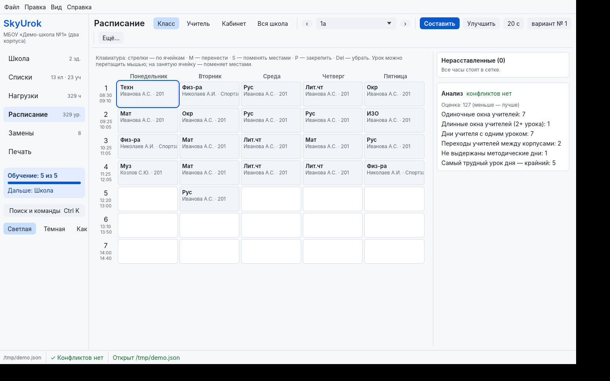
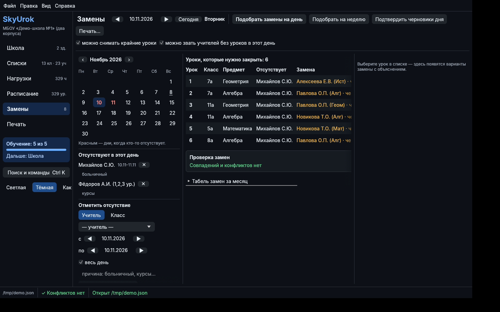
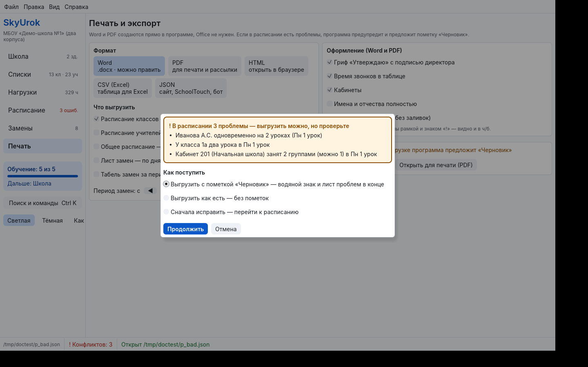

# SkyUrok

Свободная программа с открытым кодом для составления школьного расписания и замен.
Работает на **Windows, Linux и Android**, без интернета и без установки Office.



## Что умеет

**Расписание**
- «Составить» и «Улучшить» в фоне: закреплённые уроки не трогаются, по окончании видно сравнение «было / стало».
- Несколько зданий со своими звонками и временем дороги между ними.
- Группы, потоки из нескольких классов, спаренные уроки, методические дни, график доступности учителей.
- Анализ: конфликты, окна, переходы между зданиями, нагрузка по СанПиН. Клик по ошибке ведёт к уроку.
- Ручная правка мышью и с клавиатуры: при переносе каждая ячейка помечена «✓ можно» или «× нельзя» с причиной.

**Замены**
- Отсутствие учителя на дни или отдельные уроки, отсутствие целого класса (экскурсия, карантин).
- Для каждого урока — варианты замены с объяснением: «ведёт этот предмет», «у него окно», «то же здание».
- «Подобрать на день / на неделю» одной кнопкой, проверка на совпадения, табель замен.

**Печать и выгрузка**
- Word (.docx) и PDF прямо из программы: расписание классов и учителей, общее, лист замен, табель.
- Если в расписании есть ошибки, выгрузить всё равно можно — с пометкой «Черновик» и списком проблем.
- HTML для браузера, CSV для Excel, JSON для сайта школы, информационного киоска или бота.

**Удобство**
- Светлая, тёмная и автоматическая темы с проверенным контрастом; масштаб интерфейса до 200%.
- Обучение «Первые шаги» и поиск по всему (Ctrl+K), который понимает неправильную раскладку.
- Автосохранение, восстановление после сбоя, отмена и повтор.

| Тёмная тема | Предупреждение при выгрузке |
|---|---|
|  |  |

## Установка

Готовые файлы — на странице [последнего релиза](https://github.com/skysyndicatecorner/skyurok/releases/latest).

| Система | Файл | Как установить |
|---|---|---|
| Windows 10 и 11 | `SkyUrok-windows-x64.zip` | Распаковать в любую папку, запустить `SkyUrok.exe` |
| Debian, Ubuntu, Astra Linux | `skyurok_*_amd64.deb` | Двойной щелчок или `sudo apt install ./skyurok_*_amd64.deb` |
| РЕД ОС, Альт, Fedora | `skyurok-*.x86_64.rpm` | `sudo dnf install ./skyurok-*.rpm` или `sudo apt-get install ./skyurok-*.rpm` (Альт) |
| Любой Linux | `SkyUrok-linux-x86_64.tar.gz` | Распаковать, запустить `./install.sh` (без прав администратора) |
| Android 7+ | `SkyUrok-android.apk` | Предварительная версия: удобнее на планшете |

Linux-сборка работает на системах с glibc 2.28 и новее: Astra Linux 1.7, РЕД ОС 7.3, Альт 10, Debian 10, Ubuntu 20.04.

**Windows предупреждает о «неизвестном издателе».** У программы нет платной цифровой подписи. Нажмите «Подробнее» → «Выполнить в любом случае». Проверить, что файл не изменён, можно по `SHA256SUMS.txt` из того же релиза.

## Быстрый старт

1. Запустите программу и нажмите «Демо-школа» — откроется пример на 13 классов и два здания.
2. «Расписание» → «Составить». Через 15–20 секунд появится вариант и сравнение с текущим.
3. «Замены» → отметьте учителя отсутствующим → «Подобрать замены на день».
4. «Печать» → «Word» или «PDF» → «Сохранить…».

Для своей школы: «Новая школа», дальше программа проведёт по шагам «Школа → Списки → Нагрузки → Расписание → Замены».

## Если вы пришли из другой программы

- Файл **.rtt** переносится через «Файл → Импорт из другой программы»: классы, кабинеты и предметы с баллами трудности.
- Классы, учителей, предметы и кабинеты удобно вставить из Excel или Word кнопкой «Добавить списком» в разделе «Списки». Нагрузки класса быстро набираются в разделе «Нагрузки».
- Если перенос сработал не полностью, опишите проблему в [Issues](https://github.com/skysyndicatecorner/skyurok/issues) и, если можно, приложите файл без персональных данных — это поможет доработать импорт.

## Где хранятся данные

Проект — один файл `.json` в открытом формате, лежит там, где вы его сохранили. Настройки, автосохранения и журнал сбоев `crash.log`:

- Windows: `%APPDATA%\skyurok\data`
- Linux: `~/.local/share/skyurok`

Путь также показан в «Справка → О программе». В проекте есть ФИО сотрудников, поэтому храните его как служебный документ.

## Если что-то не работает

| Что происходит | Что сделать |
|---|---|
| Окно не открывается на Linux | Проверьте, что установлены `libgl1` и `libxkbcommon0`; запустите из терминала `skyurok-app` и пришлите вывод |
| Не открывается диалог «Сохранить» на Linux | Установите `xdg-desktop-portal` и портал для вашего окружения (`-gtk` или `-kde`) |
| Мелкий текст | «Вид → Масштаб интерфейса» или Ctrl + / Ctrl − |
| Программа закрылась с ошибкой | Откройте её снова — автосохранение предложит восстановить проект. Пришлите `crash.log` в Issues |

## Сборка из исходников

Нужен Rust (stable).

```sh
cargo test --workspace --release               # тесты
cargo build --release -p skyurok-app            # программа
cargo build --release -p skyurok-cli            # консольная утилита skyurok
```

Консольная утилита умеет всё основное без окна: `skyurok solve`, `skyurok check`, `skyurok doc проект.json расписание.pdf --what classes,reps`. Список команд — `skyurok --help`.

Готовые сборки для всех систем делает GitHub Actions (`.github/workflows/build.yml`). Новый релиз: поставьте тег `vX.Y.Z` и отправьте его на GitHub — файлы и контрольные суммы появятся в Releases сами.

```
crates/core   ядро: модель, генератор, анализ, замены, печать, импорт
crates/app    приложение (egui): Windows, Linux, Android
crates/cli    консольная утилита skyurok
examples/     демо-школа
docs/         скриншоты, заметки о форматах, тексты релизов
```

## Лицензия

© 2026 skysyndicatecorner. SkyUrok — свободная программа под лицензией [GNU AGPL-3.0 или более поздней версии](LICENSE).

- Пользоваться можно бесплатно и без ограничений: в школе, дома, в любой организации.
- Код можно изучать, изменять и распространять.
- Любая изменённая версия или программа, сделанная на основе SkyUrok, должна выходить под той же лицензией вместе с исходным кодом. Это касается и тех, кто запускает изменённую версию как онлайн-сервис: пользователям сервиса нужно дать ссылку на код.
- Закрыть код или продавать доработанную версию как закрытую программу нельзя.

Шрифты Inter (SIL OFL 1.1) и DejaVu Sans (Bitstream Vera) распространяются по своим лицензиям — см. `crates/app/assets/FONTS.md`.

Баллы трудности предметов в демо-школе примерные. Перед утверждением расписания сверьте их с действующими санитарными нормами.
